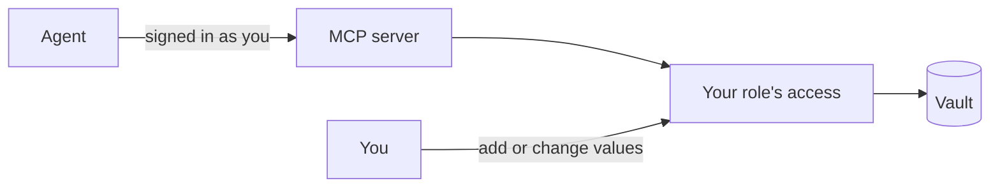

# Giving an agent secrets safely

A coding agent that cannot see your environment variables writes code that guesses at them. An agent with your `.env` on disk is a credential you cannot revoke. The middle path is a signed-in, audited connection that reads what your role allows and writes nothing but documentation drafts.

## The shape of it



The agent reads what your role can read. Every value it reads is logged against you, and it can never change a secret.

## Set it up

<Steps>

### Connect the client

```bash
claude mcp add --transport http --scope user \
  envpilot https://www.envpilot.dev/api/mcp
```

No header and no key. Set it up with a key before? Run `claude mcp remove envpilot` first: Claude Code keeps an existing entry, header included, and never offers sign-in. Other clients: [Connecting a client](/mcp/clients).

### Sign in

Run `/mcp`, choose `envpilot`, then **Authenticate**. Sign in with the Envpilot account whose access the agent should have.

### Verify the tools loaded

Run `/mcp` inside a session. A server that is _listed_ is not the same as a server whose tools are _live_.

</Steps>

## What a good session looks like

1. The agent calls `envpilot_list_projects` to find the project.
2. It calls `envpilot_get_variables` with `metadata_only` to see which keys exist — no decrypt, no audit entry, no values in its context window.
3. It reads only the specific values it needs, by key.
4. Missing something? The agent tells you, and you add the variable in the dashboard yourself.

Step 2 is the habit worth encouraging in your prompt: **look at key names first, fetch values last**. Most code an agent writes needs to know a variable exists, not what it says.

## Guardrails you get for free

| Risk                            | What stops it                                                      |
| ------------------------------- | ------------------------------------------------------------------ |
| Agent edits a production secret | No MCP tool writes a variable                                      |
| Agent publishes a page          | It can only write drafts; a person publishes in the dashboard      |
| A token leaks into a log        | It only works on the MCP server and expires; remove the connection |
| You leave the organization      | The connection loses access with your membership                   |
| You need to know what it read   | Every value read is audited against your user                      |

## Guardrails you must add yourself

- **Sign in with the right account.** The agent sees the projects, environments, variables and documentation that account can see, production included.
- **Ask for development.** Tell the agent which environment to read; it can read any your role allows.
- **Disconnect when you are done.** Remove the server from the client so it stops renewing its token. A token already issued keeps working until it expires.
- **Watch the context window.** Once a value is in a transcript, it lives wherever that transcript lives.

<Callout type="warning" title="The agent's context is not a vault">
  Envpilot controls what an agent can fetch, not what happens after. Anything
  read into a conversation may be stored by the client, synced, or reviewed
  later. Treat every value an agent reads as disclosed to that client's whole
  retention policy.
</Callout>

## Limits

- Pro plan (`mcp_server`), re-checked on every call.
- A connection has your access; there is no way yet to give the agent less.
- Shared accounts, secret files and variable requests are not available over MCP.
- Rate limits apply per person.

## See also

- [MCP overview](/mcp/overview) · [Tools](/mcp/tools) · [Agent requests](/mcp/agent-requests)
- [Architecture](/start/architecture) — the trust model in full
