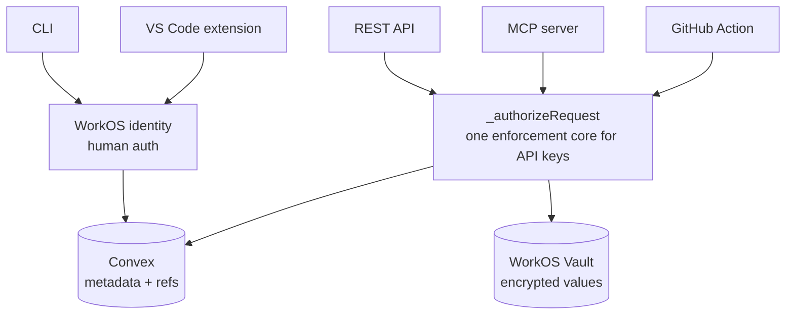

# Architecture: the machine surfaces

Envpilot exposes your projects and variables through five client surfaces. Two are driven by a human at a keyboard, two are driven by programs, and one is a hard-locked CI reader. They differ in how they authenticate and in what they are allowed to do — but they all funnel through a **single enforcement core**, so there is exactly one place where scope, plan, and audit are decided.

## The five surfaces

| Surface           | Who drives it         | Auth                               | What it can do                |
| ----------------- | --------------------- | ---------------------------------- | ----------------------------- |
| CLI               | A human               | WorkOS device flow (browser login) | Read and write (role-gated)   |
| VS Code extension | A human               | WorkOS device flow (browser login) | Read and write (role-gated)   |
| REST API          | A program             | API key (`envpk_…`)                | Read                          |
| MCP server        | An agent, as a person | OAuth sign-in (browser login)      | Read (role-gated), draft docs |
| GitHub Action     | CI                    | API key (`envpk_…`)                | Read only — never requests    |

The CLI and the VS Code extension are **human** surfaces: a person completes a WorkOS device-flow login in a browser, and their organization/project role decides what they can read and write. The MCP server signs an agent in as a person too, so that person's role decides what it reads. The REST API is a **machine** surface: a program presents an API key. MCP used to take API keys as well; see [API keys (legacy)](/mcp/api-keys). The GitHub Action is a machine surface too, but a deliberately narrow one — a CI reader locked to a single project's variables.

## One key, one core

Every machine surface authenticates with the same credential: an **API key** minted in **Organization Settings → API Keys**. There is no separate "service token" concept anymore — Action credentials are API keys with the GitHub Action surface selected.

A key carries:

- **A SHA-256 hash only.** The plaintext `envpk_…` is shown exactly once at creation; Envpilot stores only its hash. Lose it, and you revoke and re-issue.
- **Scope** — projects (all or a list), environments (all or a list), and resources (`variables`, `accounts`, `projects`, optionally `files`, and optionally `requests`). The `files` resource, which unlocks [secret files](/platform/secret-files), is never granted by default.
- **Surfaces** — which faces the key may use: `rest_api`, `github_action`, `docker`. Older keys may also list `mcp_server` (legacy).

Because every key surface (REST, the GitHub Action and Docker) routes through one authorizer, there is no second implementation of "is this key allowed" to drift out of sync. Denials are **returned, not thrown**, so the audit write always survives; an unknown, revoked, or expired key gets one uniform answer; and the plan gate (`public_api`, or `docker_image` for Docker) is re-checked on **every** request.

## The trust model: machines read, people write

The core rule for machine credentials is simple: **a machine credential never writes a secret.** No API key — for the REST API, the GitHub Action or the Docker image — can create, edit, or delete a variable's value. A leaked key is bounded to _reads within its scope_.

GitHub Action keys are the strict case: they read a single project's variables, plus its [secret files](/action/secret-files) if the key was explicitly given the `files` resource.

The MCP server signs an agent in as a person, so it reads what that person's role allows and writes nothing but documentation drafts, which a person publishes. Agents used to file variable requests with an API key; that path was removed when MCP moved to sign-in. See [Agent requests](/mcp/agent-requests).

## Limits of this model

- **No machine credential can write a secret.** There is no endpoint, tool, or flag that changes this.
- **Scope is immutable** on an API key — widening access means minting a replacement.
- **Human surfaces need a browser** for the device flow; a headless machine cannot sign in as a person.
- **Machine surfaces are available on every plan** (`public_api`, `mcp_server`, `docker_image`) and the gate is re-checked per request.
